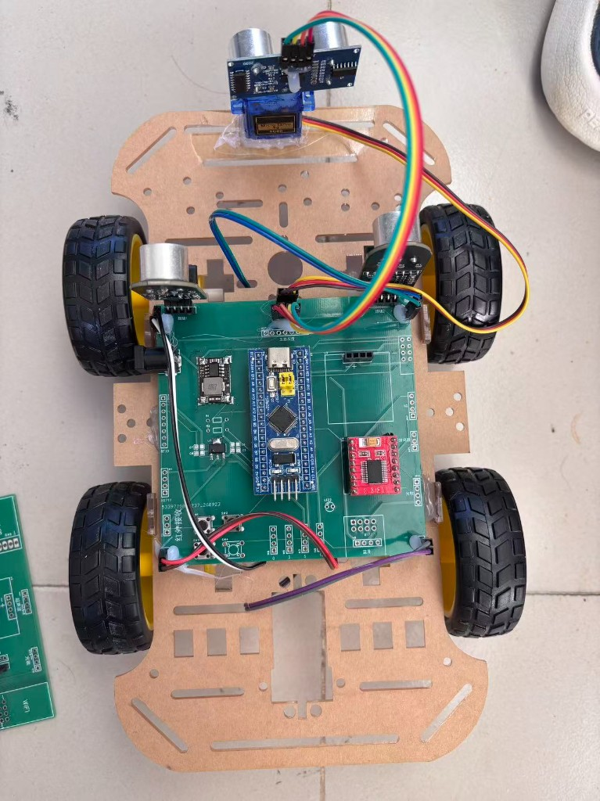
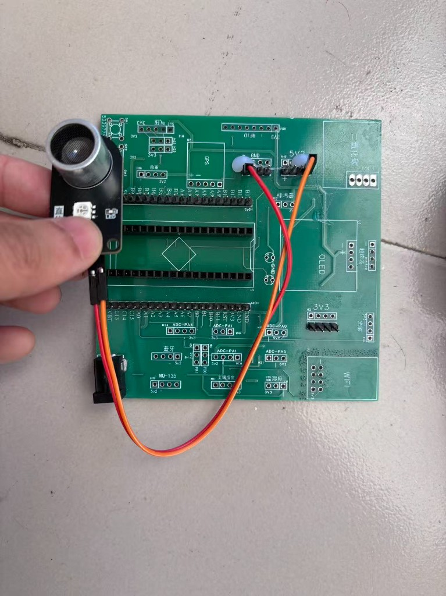

# 基于STM32 + FreeRTOS的智能跟随与避障小车

## 项目简介

STM32F103C8 标准外设库工程。三个按键切换停止、双超声波跟随和舵机扫描避障。任务、队列和软件定时器全部静态创建，停止键可以打断正在进行的测距和转向。

## 演示

实车照片：





B 站演示视频（点击封面跳转播放）：

[](https://www.bilibili.com/video/BV1RCxz6iEzF)

- [基于stm32的智能跟随小车](https://www.bilibili.com/video/BV1RCxz6iEzF)（约 1 分 21 秒）

账号空间：[bili_77888709002](https://space.bilibili.com/1374157254)

原理图：[docs/schematic.pdf](docs/schematic.pdf)

## 硬件平台

引脚来自本仓库源码（`Core/Src/TB6612.c`、`Follow.c`、`HCSR04.c`、`Servo.c`、`car_rtos.c`）。

| 模块 | 型号 / 接口 | 连接 |
|------|-------------|------|
| MCU | STM32F103C8，72 MHz | 标准外设库 |
| 电机驱动 | TB6612 | 右轮 PWM：PB8 / TIM4_CH3，方向 PB5、PA5；左轮 PWM：PB9 / TIM4_CH4，方向 PC15、PC14。STBY 硬件拉高 |
| 跟随测距 | 两路串口超声波，115200 | 右侧 USART1 RX = PA10，左侧 USART2 RX = PA3。帧头 `0xA5` + 2 字节距离（mm） |
| 避障测距 | HC-SR04 | Trig = PA0，Echo = PA1 / TIM2_CH2 输入捕获，1 个计数 = 1 us |
| 舵机 | SG90，50 Hz | PB0 / TIM3_CH3。正前 40°，左右各偏 45° |
| 按键 | 上拉输入 | 跟随 PB3，停止 PB4，避障 PB10。关闭 JTAG，保留 SWD |
| 调试接口 | SWD | PA13 / PA14 |

五路灰度循迹驱动留在 `Core/Src/Trace.c`，当前三个模式的调度循环没有调用它。

## 技术栈

C、FreeRTOS、UART、PWM、输入捕获、Keil MDK、STM32 标准外设库、Cursor。

## FreeRTOS 任务架构

原生 FreeRTOS 静态分配，`configSUPPORT_DYNAMIC_ALLOCATION = 0`。Tick = 1000 Hz。栈大小单位是字，1 字 = 4 字节。

| 任务名 | 优先级 | 栈大小 | 功能 | 通信方式 |
|--------|--------|--------|------|----------|
| KeyTask | 4 | 128 字 | 10 ms 采样，连续 2 次相同才确认按键 | 模式变化后 `xTaskNotify` 控制任务 |
| ControlTask | 3 | 384 字 | 停止、跟随、避障 | 等待模式、回波和断链通知 |
| FollowTask | 2 | 256 字 | 解析两路串口帧，连续 3 次有效后取平均 | 1 深度队列覆盖最新距离 |
| 定时器任务 | 3 | 192 字 | 300 ms 无新帧判定链路丢失 | 通知控制任务停车 |
| 空闲任务 | 0 | 128 字 | 系统空闲 | 无 |

其它对象：

- 距离队列：1 × `FollowRange`，`xQueueOverwrite` 只保留最新一帧。
- 链路定时器：单次 300 ms，收到新帧后重置。
- 串口和 TIM2 抢占优先级为 6，低于系统调用线 5，中断里可以调用 `FromISR`。

## 关键技术点

### 1. 任务划分与停止键打断

按键任务优先级最高，只做消抖和发通知。跟随解析放在更低优先级，避免在中断里做滤波。控制任务用任务通知同时等待模式切换、超声波回波和链路丢失。`Car_WaitMs()` 与 `Car_MeasureCm()` 在超时前若收到模式通知，会立刻停掉当前测距或转向。

### 2. 双路串口跟随

USART1 为右侧，USART2 为左侧，帧格式是 `0xA5` 加 2 字节距离。大于 4000 mm 视为无效；连续 3 次有效后取平均，连续 3 次无效则距离记 0。左右距差超过 20 mm 时差速转向，否则直行。负的轮速表示前进。300 ms 没有新帧则停车。

### 3. HC-SR04 输入捕获与避障

Echo 接到 TIM2_CH2，上升沿和下降沿由硬件锁存，脉宽不包含中断响应时间。正前距离取 5 次有效值的中值。大于 30 cm 前进；进入 30 cm 后停车，舵机扫左侧和右侧，倒车，再朝空间更大的一侧转向。

### 4. 全静态内存

任务、队列和软件定时器都用 `xTaskCreateStatic`、`xQueueCreateStatic`、`xTimerCreateStatic` 创建，不从堆上分配。中断优先级放在 `configLIBRARY_MAX_SYSCALL_INTERRUPT_PRIORITY` 以下，`FollowTask` 由 `vTaskNotifyGiveFromISR` 唤醒。

## 目录结构

```
├── Core/
│   ├── Inc/                 # 应用头文件（FreeRTOSConfig、跟随、避障、驱动）
│   └── Src/                 # 应用源文件
│       ├── main.c
│       ├── car_rtos.c       # 按键任务、控制任务、静态内存
│       ├── Follow.c         # 双路串口跟随
│       ├── mycontrol.c      # 避障
│       ├── HCSR04.c
│       ├── Servo.c
│       └── TB6612.c
├── Drivers/
│   ├── CMSIS/               # 内核、设备头文件、启动文件
│   └── STM32F10x_StdPeriph_Driver/
├── Middlewares/
│   └── Third_Party/FreeRTOS/Source/
├── MDK-ARM/
│   ├── Follow.uvprojx       # Keil 工程
│   └── Follow.uvoptx
├── docs/
│   ├── images/
│   └── schematic.pdf        # 原理图
├── README.md
└── LICENSE
```

本工程使用标准外设库，因此驱动目录是 `STM32F10x_StdPeriph_Driver`，不是 HAL。

## 编译与烧录

1. 使用 **Keil MDK** 打开 `MDK-ARM/Follow.uvprojx`。
2. 选择目标 `Target 1`，Rebuild。生成文件位于 `MDK-ARM/Objects/` 和 `MDK-ARM/Listings/`（已加入 `.gitignore`）。
3. 用 **ST-Link** 或 **DAP-Link** 通过 SWD（PA13/PA14）下载。

推荐工具链：Keil MDK-ARM，ARM Compiler 5。

## 作者

姓名：李润欣  
GitHub：[lrx-6665](https://github.com/lrx-6665)  
邮箱：2339043687@qq.com

## 许可证

MIT License
